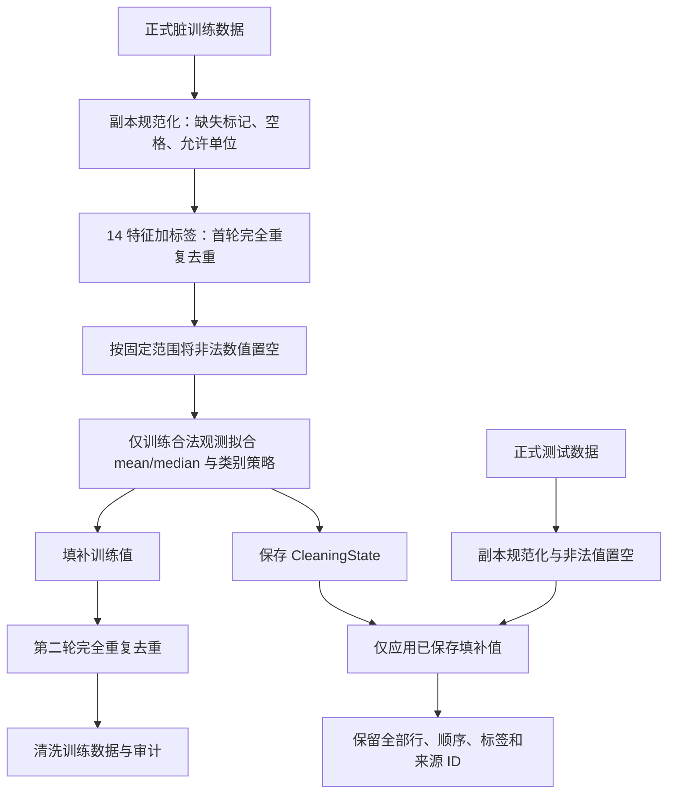

# 成员 B：格式规范化与数据清洗

业务契约 v1.0。复用 `src.schema` 公共常量与 Pydantic 类型，不改变冻结接口。

## 数据流与原则
- `normalize_frame(df)`：在独立副本中识别缺失、裁剪类别空格、转换普通数字与允许的单位；保留非法范围的已解析值供 A 检测；数值解析失败设为 NaN。索引/顺序/标签/元数据保持不变。
- `clean_training_data(train_df, plan)`：规范化 → 使用 14 个特征 + income 去重（不含元数据）→ 范围非法数值置空 → 仅从训练记录计算数值均值/中位数与类别众数/Unknown → 填补 → 再去重。仅重复行允许删除。
- `transform_test_data(test_df, cleaning_state)`：规范化 → 范围非法置空 → 只应用训练保存的填补值。绝不去重、拟合、修改状态或更改标签和来源信息。
- 全无有效数值观测抛 `DataValidationError`；类别全缺失采用 Unknown 并在训练审计中警告。众数并列按字符串排序取首项。
- 格式修改单元格、非缺失解析错误、范围置空、填补数量、两轮去重各自独立审计，不相加为“问题行数”。
- 数值范围以 `NUMERIC_BOUNDS` 为准；`fnlwgt` 必须严格大于 0。
- 不写全局日志，不调用 LLM/API；C 在其 pipeline 记录事件。

## 样例复现
运行 `python checks/check_B.py` 或 `python checks/check_B.py --integration`。
共享训练样例由 8 行变成 7 行，首次去重 1 行；age=-5 和 hours_per_week=999 被置空后由训练中位数填补为 38.5、40；字符串单位 `40 hours` 解析成 40；问号工作类别与空教育填为 Unknown。
共享测试样例全部 3 行保留，`Unseen-example-workclass` 不改，不在测试集学习统计量。
参考文件 `examples/clean_train_small.csv` 和 `examples/cleaning_state_example.json` 仅作为离线样例对照，不是实际实验。

## 自测覆盖
重复规范化幂等、输入不可变、重复与二次重复、数值异常与不支持单位、全缺失数值失败、类别全缺失警告、类别众数并列、未知测试类别、重复测试行不删、模型填补状态不变、行序与标签/来源 ID 不变、共享参考样例数值对照。
正式 Adult 数据、真实模型调用、D 分类器和全流程不在 B 的本地小样例通过范围内。

## 2026-11-02 成员 B 第二阶段正式复验（Codex 当前会话）

本节是本次真实分支上的新执行记录，上方初版范围说明保留为历史。先只读检查 F 盘原仓库（干净的旧 main），在独立工作副本建立 `member-b-clean`，实际 fetch 并快进合入 `origin/main`，基线为 `65e7b651e068e628c969603278dfaf7993982464`。没有改动原仓库或 main。

本轮使用 A 的 `data.zip`：正式 CSV、原始 Adult 文件及清单哈希逐项核对；既有受跟踪清单保持原样，没有重建划分或注入。两个 B 成果包逐项审查后复用案例与验证脚本，旧结果另存为历史；新运行与历史 CSV 的解析后数据表、训练/测试审计一致。过程见 `evidence/B/archive_review_codex_20261102.json`，新正式收据见 `evidence/B/formal_codex_20261102.json`。

### 策略、固定范围与真实缺陷修复

- 数值 `mean/median` 均从规范化、首次去重、范围置空后的合法训练观测拟合；类别 `most_frequent/constant` 全部可执行。constant 固定使用 `Unknown`，众数并列按字符串字典序取首项，类别全缺失用 Unknown 并警告。
- 固定范围：age ∈ [17,120]；education_num ∈ [1,16]；hours_per_week ∈ [1,168]；fnlwgt > 0；capital_gain、capital_loss ≥ 0，后三列没有契约上界。按契约判断，不能凭数值大或分类成绩改阈值。
- 允许的单位只包含 age 的 year/years，以及 hours_per_week 的 hour/hours/h（忽略大小写）；普通数字和前后空格可解析，不支持的单位/数字文本置空并单独记解析错误。
- 实际复现缺陷：`model_copy(update=...)` 或赋值可以绕过 Pydantic 的构造校验。旧清洗入口可能接受非法策略/步骤、错误特征状态或与 constant 不一致的类别填充值，甚至静默回落到 median。现仅在 B 清洗入口重新验证计划/状态，检查数值范围、缺失类别标记和 constant=Unknown 一致性，统一抛 `DataValidationError`。正常清洗算法和结果保持一致，冻结接口和哈希未改。
- 原 33 项样例检查保留，新增 11 项缺陷回归断言；本次最终锁定环境下 44 项通过。首次缺依赖和修复前失败输出保留。原始缺陷复现使用内置环境；最终验收使用 Python 3.12.13 和 requirements.txt 锁定的七项直接依赖，二者明确区分。

### 正式规则审计及行数解释

本次直接调用真实 A 检测器、C 的 rules 计划入口和 B 模块；不是完整 pipeline，没有 pipeline run_id，不包含分类器成绩或新模型请求。计划为 median / constant Unknown。

| 项目 | 本次结果 | 口径 |
| --- | ---: | --- |
| 训练输入 → 输出 | 7,140 → 7,000 | 只有完全重复行被删除 |
| 首轮 / 填补后去重 | 140 / 0 行 | 键为 14 特征 + income，排除元数据 |
| 范围非法置空 | 70 格 | 修改单元格，不删行 |
| 缺失填补 | 5,780 格 | 在首轮去重后计数 |
| 格式变化 / 解析错误 | 1,218 / 0 格 | 在原始训练输入上规范化计数 |
| 测试输入 → 输出 | 3,000 → 3,000 | 保留索引、顺序、标签、两个来源 ID |
| 测试填补 | 431 格 | 只应用训练状态，不重新拟合 |

`7140 - 140 - 0 = 7000`。本轮真实 A 检测得到训练初始缺失 5,815 格，首轮删除行含 105 格缺失，范围置空再增加 70 格，因此 `5815 - 105 + 70 = 5780`。四类计数可重叠、计数阶段和单位不同，不能相加当作问题行数。清洗后 A 检测的训练缺失/重复/异常/格式均为 0。

训练输出的标签和 ID 对应保留行逐项一致；测试行数/索引/标签/两个 ID 原样保留。训练与测试输入副本、训练 CleaningState 均未被修改。两个 ID 与标签不进入模型特征；标签仅参与完全重复键，防止把特征相同但标签不同的行误删。

### 四类正式数据案例（本轮实际输出）

| 类型 | 来源 ID / 字段 | 处理前实际值 | 规则 | 处理后 | 对应证据 |
| --- | --- | --- | --- | --- | --- |
| 缺失 | S016453 / native_country | `?` | 缺失标记 → constant Unknown | `Unknown` | 新正式收据 cases[0]，输入位置 3484 |
| 重复 | S025957 / 14 特征 + income | 输入位置 5565、7000 的完整规范化键相同 | 首轮 keep=first；元数据不参与键 | 保留原位置 5565，删除 7000 | cases[1]，首轮 140 行中的一行 |
| 异常数值 | S002083 / age | `-5` | [17,120] 外 → NaN → 合法训练 age 中位数 | `37.0` | cases[2]，输入位置 434，state.numeric_fill_values.age |
| 格式问题 | S010642 / fnlwgt | ` 363591 `（两侧空格） | 去空格并解析；合法正数 | `363591.0` | cases[3]，输入位置 2251 |

表中输入位置是从 CSV 读入后的 0 起始 DataFrame 位置；输出 CSV 因去重发生位置变化。完整证据保存原位置、输出位置和 group_id。重复案例实际核对了完整键与保留索引，不能仅凭 source_id 声称一对一映射。四项与当前 `docs/report.md` 的既有案例值一致；由 B 完成此规则范围的文字复核，D 可据此更新其验收清单。

### 四种允许组合实跑

| 数值 | 类别 | 训练输出 | 首轮 / 后轮去重 | 测试输出 |
| --- | --- | ---: | --- | ---: |
| mean | most_frequent | 6,998 | 140 / 2 | 3,000 |
| mean | constant Unknown | 7,000 | 140 / 0 | 3,000 |
| median | most_frequent | 6,998 | 140 / 2 | 3,000 |
| median | constant Unknown | 7,000 | 140 / 0 | 3,000 |

每种组合都逐列独立核对训练填补值、保护列、输入副本和状态。C 当前模型提示词的白名单与这四种组合一致；此为代码核对，没有向 C 发消息或新增真实请求。most_frequent 填补后额外 2 条重复解释了 6,998 的合法结果，不能把 7,000 硬编码为所有策略的正确答案。

### 报告/PPT 清洗流程图

### 三项答辩问题

1. **为什么测试集不能重新算填补值？** 预处理参数也是从数据学习的结果；使用测试分布会引入信息泄漏。测试只应用训练期保存的 CleaningState。
2. **为什么填补后还要去重？** 原先不同的缺失行填补后可能变成相同完整键。本轮 most_frequent 组合就额外产生 2 条重复训练记录；测试集即使重复也保留。
3. **异常值与合法大数值如何区分？** 使用冻结的逐列范围。例如 fnlwgt=363591 是合法正数，capital_gain/loss 不自加上限；age=-5 明确越界。不会根据测试指标修改阈值。

### 验证边界与复现

本次新执行：foundation、B 44 项真实模块自测、四组合正式数据辅助验证、成果包两个既有脚本重跑、B AI 账本检查及 B submit。完整输出见 `outputs/member_B/codex_20261102/`，正式验证入口是已提交的 `evidence/B/verify_stage2.py`。旧脚本的当次新输出保存在 `outputs/member_B/`，与 archive_review 中原包分开。

当前 main 的 C/D 历史记录已包括真实 DeepSeek 成功运行和独立服务器复现，本节不将其改写成待配置。本次没有模型 API 请求，未独立取得历史模型运行 CSV 作字节复验，没有重新计算分类指标，也没有运行 D 专属 main 集成门禁。真实模型可选相同或另一合法组合；6,998/7,000 与指标必须绑定各自运行。本次开发模型仅可确认 GPT-6 基础身份，精确后缀、token、内部请求数和费用未知，账本保持 null。
