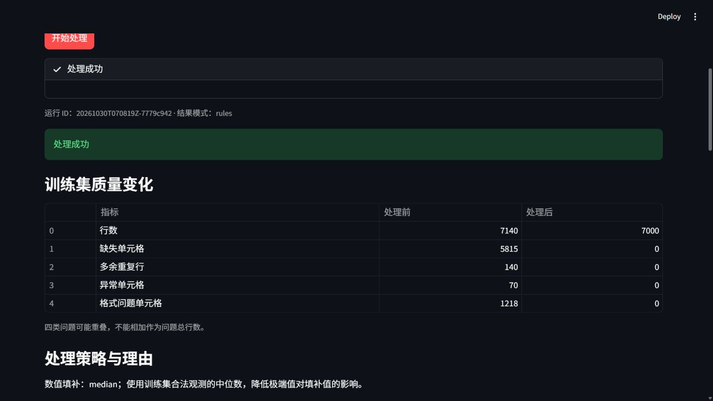
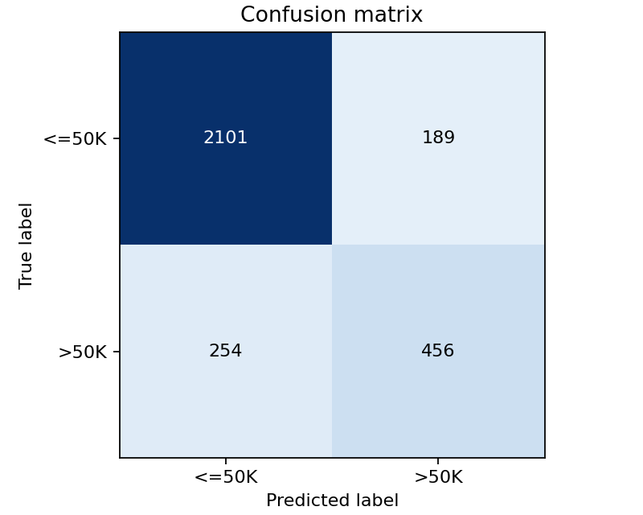

# 基于大模型的数据自动清洗与分类智能体

规则模式实测报告；真实模型与真人验收待补。

## 基于大模型的数据自动清洗与分类智能体

课程项目报告 · 规则模式实测版 · 2026-10-30

本项目针对固定 Adult 表格实现质量检测、计划校验、清洗工具执行、分类评估及结果导出。四个初版已合入 main。本文使用本机真实业务模块和正式数据的规则运行，不将开发样例或受控假模型当作实验结果。

### 本次结果与证据范围

| 项目 | 实际结果 |
| --- | --- |
| 数据规模 | 7,140 行脏训练，7,000 行处理后训练，3,000 行测试 |
| 分类 | Accuracy 85.23%，Macro-F1 0.788846 |
| 质量 | 四类训练问题按固定口径复查均为零 |
| 真实模型 | 尚未配置，未发出实际模型请求，保留待验证 |
| 人工页面 | 本机浏览器运行、模式切换及三类文件下载已检查 |

本次主要运行 ID：20261030T070819Z-7779c942；模式为 rules。训练和测试来源组无交叉，所有填补、编码和标准化参数仅从训练集学习。未为提高指标改变测试集或搜索模型。

### 任务目标与边界

课程要求至少 5,000 条记录、至少 10 个字段，并覆盖缺失、重复、异常及格式不一致。项目固定使用 14 个特征，仅采用逻辑回归。模型模式的职责限定为依据训练摘要选择白名单填补策略并说明理由，执行仍由确定性 Python 工具完成。

目前规则流程可以证明本地数据处理和分类能力。尚缺真实模型成功链条、另一位成员的跨机复现和实际全员排练，因此本文不是课程全部验收通过证明。成员姓名和口头展示分工待本人确认。

<!-- pagebreak -->

## 数据来源、构造与划分

数据来自 UCI Adult，官方页面给出 14 个特征并注明存在缺失值。完整发布集包含 48,842 条记录；本项目只使用 adult.data 文件中的 32,561 条记录，不混称两种规模。数据许可为 CC BY 4.0。[1]

| 阶段 | 行数 | 用途 |
| --- | --- | --- |
| 原始 adult.data | 32,561 | 保留官方原件及 SHA-256 |
| 固定抽样参考池 | 10,000 | seed=42，不称为无缺失真值 |
| 参考训练 / 测试 | 7,000 / 3,000 | 按规范化14特征签名分组 |
| 注入问题后训练 | 7,140 | 复制保留原来源关联 |
| 规则处理后训练 | 7,000 | 仅去重删行，测试不删行 |

先按规范化特征的 SHA-256 稳定签名分组划分，再仅向训练集注入问题。同一来源组不能跨训练和测试；复制行保留 _source_id 与原 _group_id。income、_source_id、_group_id 均不进入特征。

| 注入审计项 | 本次准备摘要 |
| --- | --- |
| 新增缺失单元格 | 4,857 |
| 新增格式单元格 | 1,198 |
| 异常记录 | 70 |
| 复制记录 | 140 |

上表是问题构造审计，不是检测器答案。参考数据原生缺失、复制携带问题和格式单元格重叠，使最终检测数与注入数不必相等。manifest 仅用于离线核查，不输入检测器、模型或分类器。

原始 SHA-256：5b00264637dbfec36bdeaab5676b0b309ff9eb788d63554ca0a249491c86603d。此次复用本地已校验官方原件，未无故重新下载。docs/data.md 为集成人补齐的说明，仍需 A 确认文字与素材。

<!-- pagebreak -->

## 处理方法与智能体职责

| 阶段 | 实现及边界 |
| --- | --- |
| 检测 A | 共享 B 规范化视图，保留输入，分别统计缺失/重复/异常/格式 |
| 计划 C | rules 固定计划；llm 仅接收训练摘要，最多两次请求 |
| 校验 C | 固定步骤与字段白名单，非法 JSON/策略拒绝 |
| 清洗 B | 规范化、首轮去重、非法值置空、训练拟合填补、最终去重 |
| 分类 D | 训练标准化和独热编码，LogisticRegression 预测测试集 |
| 日志及界面 | C 统一导出；D 页面/CLI 共用唯一总流程 |

本次 rules 计划为数值 median、类别 constant/Unknown。数值理由为使用训练合法观测的中位数，降低极端值对填补值的影响；类别理由为用 Unknown 避免把缺失类别误判为常见类别。这些理由由规则入口给出，并非实际模型自主决策。

### 从正式运行提取的四类案例

| 类型 | 来源与字段 | 实际输入 | 处理后 |
| --- | --- | --- | --- |
| 缺失 | S016453/native_country | '?' | Unknown |
| 重复 | S025957/(whole_row) | 'duplicated_row' | 保留一条关联记录 |
| 异常 | S002083/age | '-5' | 37.0 |
| 格式 | S010642/fnlwgt | ' 363591 ' | 363591.0 |

案例由 D 从正式注入清单离线选取，并对照本次处理后 CSV。异常按固定范围置空后用训练统计填补；格式示例去外围空格并转数值。重复项只说明同来源的保留结果，不虚构无法辨别的复制行号。案例仍待 B 对报告措辞复核。

模型 HTTP 客户端、错误 JSON 和两次请求预算已有明确标记的受控单测。它们验证控制逻辑，不证明真实模型已调用。用户已确认尚未配置 API，本轮不反复发送失败网络请求。

<!-- pagebreak -->

## 清洗结果与审计解释

| 检测指标（训练集） | 处理前 | 处理后 |
| --- | --- | --- |
| 记录数 | 7140 | 7000 |
| 缺失单元格 | 5815 | 0 |
| 多余重复行 | 140 | 0 |
| 范围异常单元格 | 70 | 0 |
| 格式问题单元格 | 1218 | 0 |

检测以传入脏表统计，清洗先删 140 条完全重复行，再执行值处理。审计记录格式修改 1,218 格、范围非法置空 70 格、缺失填补 5,780 格；填补后第二轮去重为 0。测试集填补 431 格，保留全部 3,000 行。

5,815 个原始缺失与 5,780 次填补不能直接逐项相减：两者计算阶段不同，首轮去重先删除携带问题的复制记录，非法数值又在随后置空。四类问题可能重叠，不能相加为问题总行数。

图1 本机浏览器的真实规则运行。截图中的运行 ID 与本文一致，不是合成预览。

<!-- pagebreak -->

## 分类评估与页面验证

分类显式选择 14 特征。六个数值字段使用 StandardScaler，八个类别字段使用 OneHotEncoder(handle_unknown="ignore")，随后训练 LogisticRegression(random_state=42,max_iter=2000)。训练调用 fit，测试只转换和预测。

| 测试指标 | 本次实测 |
| --- | --- |
| Accuracy | 0.8523333333（85.23%） |
| Macro-F1 | 0.7888456818 |
| 测试类别数 | <=50K: 2,290；>50K: 710 |
| 矩阵（行真实/列预测） | [[2101,189],[254,456]] |

Macro-F1 是固定两个标签各自 F1 的等权平均，反映两个类别而不只看多数类。这里只报告一次固定测试集结果，不声称清洗提升准确率，不设结果必须高于规则模式的模型验收门槛。

人工浏览器检查了初始状态、点击一次运行、质量/策略/指标和 13 个下载入口。CSV、events.jsonl、summary.md 三份下载内容与本次输出逐字节一致。重绘/模式选择保留相同 run_id，选择 llm 不会把旧 rules 结果重标为模型结果；缺输入失败后不残留成功指标。

<!-- pagebreak -->

## 可复现性、分工与尚缺验收

共享冻结契约保持 1.0。复现采用 README 的依赖安装、固定数据准备、CLI 和 main 集成命令。源码、数据及规则日志在阶段包中同交；本机新检出/新进程运行不等于另一位真人跨机复现。

| 成员 | 已合入模块与当前材料状态 |
| --- | --- |
| A（姓名待确认） | 正式数据/检测已合入；数据说明为集成人补写，待本人确认 |
| B（姓名待确认） | 规范化与清洗已合入；D提取正式案例，待本人复核 |
| C（姓名待确认） | 规则/模型客户端与日志已合入；真实API链条待配置 |
| D（姓名待确认） | 分类/页面/CLI、集成、人工页面证据、材料和阶段打包 |

AI 使用记录按开发辅助和项目运行区分。四人现有开发记录保留，本轮 D 新增独立会话条目。实际模型标识、内部请求数、token 或费用不可取得时保留 null；订阅不按本次 0 元计算。C 的项目运行账本不能由 D 重复登记。

### 未完成项与补证要求

真实模型：需 C 在本地设置 LLM_API_URL、LLM_API_KEY、LLM_MODEL，运行生产客户端，保留实际提示词/返回、校验、工具执行、用量和成本未知项，再由 D 在 main 复验 llm。不能以规则日志代替。

真人事项：另一位成员从安装依赖和准备数据开始复现，记录操作者/环境/命令/问题；四人实际排练后记录参与人、时长及修复。当前只提供执行步骤与记录表，未宣称完成。真实模型备份/录屏亦待成功运行后制作。

### 局限与参考来源

仅支持固定 Adult 字段和明确异常范围，未评价复杂语义冲突、外部数据泛化或公平性，不支持据此进行真实个人决策。对结论的证据边界是本次规则数据处理与分类，不是已验收的真实大模型能力。

[1] Becker, B. & Kohavi, R. (1996). Adult [Dataset]. UCI Machine Learning Repository. DOI:10.24432/C5XW20。来源 https://archive.ics.uci.edu/dataset/2/adult，2026-10-30核对，CC BY 4.0。

[2] 本仓库 src/schema.py、src/contracts.py 及模块源码；docs/integration_20261030.md 为历史初版快照。本文直接证据：outputs/20261030T070819Z-7779c942/ 的质量、计划、审计、指标、事件与处理后CSV。
