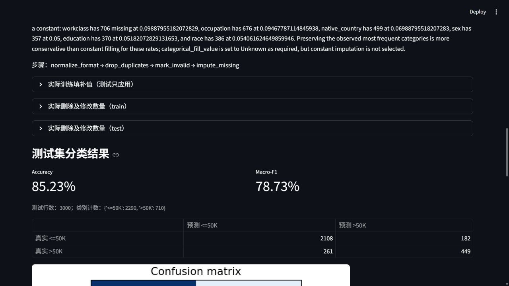
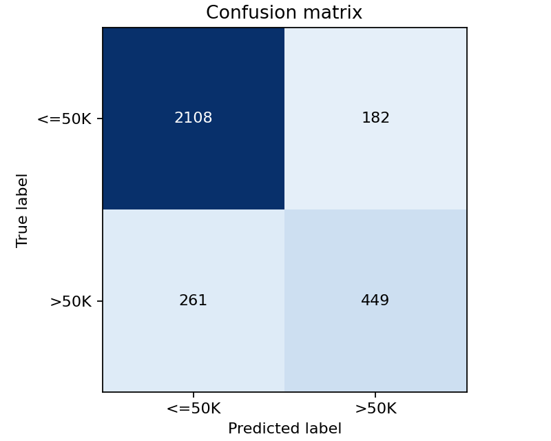

# 基于大模型的数据自动清洗与分类智能体

课程项目报告 · 正式交付版 · 2026-11-02

## 基于大模型的数据自动清洗与分类智能体

课程项目报告 · 正式交付版 · 2026-11-02

成员：宋艳婷（A）、杨陈紫逸（B）、胡宇轩（C）、周锦晨（D）。本项目面向固定Adult表格，构建从CSV输入、质量检测、训练摘要决策到工具清洗、分类评估和网页导出的完整流程。规则与真实DeepSeek流程已通过验证，并在独立云服务器运行。

### 项目目标与达成结果

| 目标 | 达成结果 |
| --- | --- |
| 规范数据输入 | 支持固定17字段CSV上传、编码与分隔符兼容，预检字段、标签及来源隔离后再执行。 |
| 依据训练分布制定计划 | 汇总缺失率、偏度、四分位数和IQR，让模型在白名单中选择填补策略并说明依据。 |
| 清洗与评估可核查 | 处理四类质量问题，展示逐列质量和实际填补值，导出审计、分类指标及混淆矩阵。 |
| 结果可展示、可复用 | 网页执行与完整历史回放共用生产流程，保留原始ID和模式，支持下载与公网HTTPS演示。 |

### 当前实测结果

主运行20261102T100936Z-a2090032（llm）：7,140条脏训练处理后保留6,998条，固定测试3,000条。模型选择median与most_frequent，四类训练质量问题归零。Accuracy为85.23%，Macro-F1为0.787282。

规则对照20261102T084136Z-d398f7b5：训练保留7,000条，Accuracy同为85.23%，Macro-F1为0.788846。两种模式采用不同类别填补策略，结果分别记录。

工程验证已覆盖独立环境安装、正式数据重建、真实模型调用、后台服务重启与公网认证访问。课堂入口：https://111.230.149.166/，独立演示口令由展示者私下提供。

<!-- pagebreak -->

## 数据来源、构造与质量检测

数据来自UCI Adult，许可CC BY 4.0。[1] 完整发布集为48,842行，本项目使用adult.data的32,561行，以seed=42抽取10,000条参考记录。参考数据保留原生缺失，不作为完整真值。

| 阶段 | 记录数 | 处理与用途 |
| --- | --- | --- |
| 原始adult.data | 32,561 | 保留原件、来源与SHA-256 |
| 参考训练/测试 | 7,000 / 3,000 | 按14特征签名分组后划分 |
| 注入后训练 | 7,140 | 仅训练侧注入，复制保留来源 |
| 本次LLM处理后 | 6,998 / 3,000 | 训练去重，测试保持全部行 |

同一_group_id不跨训练和测试。income、_source_id、_group_id不作为特征。训练参考含3行原生完全重复，7,000行对应6,997个来源组。

| 检测指标（训练集） | 处理前 | 处理后 |
| --- | --- | --- |
| 记录数 | 7140 | 6998 |
| 缺失单元格 | 5815 | 0 |
| 多余重复行 | 140 | 0 |
| 范围异常单元格 | 70 | 0 |
| 格式问题单元格 | 1218 | 0 |

缺失检测5,815格由原生853格、注入4,857格和复制带入105格组成；格式问题1,218格包含注入1,198格和复制带入20格。四类计数可重叠，不相加作为问题总行数。manifest仅用于离线审计。

本次执行先去重140行，非法置空70格，填补5,780格，填补后再去重2行。测试填补431格，保留3,000行的标签、来源ID与顺序。原始文件SHA-256：5b00264637dbfec36bdeaab5676b0b309ff9eb788d63554ca0a249491c86603d。

<!-- pagebreak -->

## 训练摘要决策与工具清洗

| 环节 | 实现方式 |
| --- | --- |
| 统计摘要 | 共用规范化视图，统计逐列缺失率及合法数值分布，保持原始输入不变。 |
| 模型决策 | 只向模型提供训练摘要，选择数值/类别填补策略并返回理由。 |
| 本地校验 | 五个白名单决策字段，固定步骤由本地设置，最多两次请求，无效计划明确失败。 |
| 执行与测试转换 | 训练侧去重、非法置空、拟合填补状态并复查重复，测试仅应用训练状态。 |

本次模型选择median：capital_gain偏度11.4218，均值1,142.0185而中位数为0；capital_loss偏度4.4913，fnlwgt偏度1.3849。数值摘要还提供四分位数和IQR，当前全部数值列共享一种策略。

类别选择most_frequent：模型引用workclass缺失率9.89%、occupation为9.47%、native_country为6.99%，认为缺失比例适中，选择观测众数。规则模式固定使用Unknown。两种选择均受白名单约束，不把模型理由作为最优性的证明。

### 处理后CSV中的四类案例

| 类型 | 来源与字段 | 实际输入 | 处理后 |
| --- | --- | --- | --- |
| 缺失 | S016453/native_country | '?' | United-States |
| 重复 | S025957/(whole_row) | 'duplicated_row' | 保留一条关联记录 |
| 异常 | S002083/age | '-5' | 37.0 |
| 格式 | S010642/fnlwgt | ' 363591 ' | 363591.0 |

案例逐项对照注入清单与本次输出CSV核对。合法数值摘要排除缺失、解析失败和越界值，少于3个观测时偏度为空。模型不读取测试摘要、测试指标或注入真值，也不执行生成代码。

<!-- pagebreak -->

## 网页处理与结果追溯

网页与CLI调用同一生产pipeline。界面依次组织输入校验、模型策略、清洗质量、实际训练状态与分类结果，列级图表和历史结果用于解释、检查与复用这条完整流程。

| 使用环节 | 页面行为 |
| --- | --- |
| 输入与预检 | 选择正式数据或上传同结构CSV，支持UTF-8/BOM、GB18030与常见分隔符。 |
| 执行与解释 | 选择rules或llm，点击开始处理创建运行，展示训练分布、策略理由、列级质量及填补值。 |
| 评估与导出 | 展示Accuracy、Macro-F1及矩阵，提供13项审计、数据、日志与图像下载。 |
| 历史复用 | 校验成功目录、完整文件和路径，保留原始run_id与模式，回放不新增模型请求。 |

图1 服务器后台服务中真实LLM运行的分类结果，显示85.23% Accuracy、78.73% Macro-F1及实际矩阵。

应用预检每份文件限制20MB，固定14特征、标签与两个来源字段共17列。重复表头、缺/多字段、坏行、非法标签、来源交叉和训练数值列无合法观测均在模型请求前拒绝。

仅点击开始处理创建新运行，预检、重绘和回放不新增请求。小样本可用于功能自测，页面明确标注训练不足5,000行，不冒充正式规模。

<!-- pagebreak -->

## 分类评估与实际调用记录

分类使用14个特征：6个数值字段经StandardScaler处理，8个类别字段经OneHotEncoder(handle_unknown="ignore")处理，再训练LogisticRegression(random_state=42,max_iter=2000)。填补、编码和标准化均只从训练集拟合。

| 模式与训练规模 | 数值/类别策略 | Accuracy / Macro-F1 |
| --- | --- | --- |
| rules，7,000行 | median / Unknown | 85.23% / 0.788846 |
| 真实llm，6,998行 | median / most_frequent | 85.23% / 0.787282 |

图2 本次真实LLM混淆矩阵，行是真实类别，列是预测类别。

测试3,000行，<=50K为2,290行，>50K为710行；矩阵为[[2108,182],[261,449]]。Macro-F1为两个标签F1的等权平均。本次模型方案的Macro-F1略低于规则对照，不能据此宣称性能提升或跨数据集泛化。

主运行实际请求1次，输入1,262、输出1,365 token。项目累计6次真实模型请求，输入5,928、输出5,652 token。temperature=0为实际参数，费用未知，保留unknown/null。

模型请求与开发辅助分账。开发内部调用/token、未核实模型或参数和费用保留null，不按零计算；受控测试不计为真实服务调用。下表模型名称沿用各人账本，完整记录见包内AI使用记录目录。

| 成员 | 模型及可获知参数 | 提示词位置 | 已知次数 / 费用 |
| --- | --- | --- | --- |
| A | 未核实；参数未知 | ai_usage/A/prompts/ | 开发未知 / 未知 |
| B | GPT-6；参数未知 | ai_usage/B/prompts/ | 开发未知 / 未知 |
| C | 开发GPT-6；运行deepseek-flash，temperature=0 | ai_usage/C/prompts/ | 运行6次；开发未知 / 未知 |
| D | 未核实；参数未知 | ai_usage/D/prompts/ | 开发未知 / 未知 |

<!-- pagebreak -->

## 工程验证、成员工作与交付

| 成员 | 完成的主要工作 |
| --- | --- |
| A 宋艳婷 | 正式数据准备、来源记录、分组划分、问题注入与质量检测。 |
| B 杨陈紫逸 | 共享格式规范化、训练清洗、测试转换与清洗审计。 |
| C 胡宇轩 | 模型客户端、计划生成、总流程与运行日志。 |
| D 周锦晨 | 分类器、网页与CLI、输入预检与历史回放、训练摘要增强、模型边界校验、端到端集成、服务器部署和交付材料。 |

### 已完成的验证

共享契约1.0保持冻结。A60项断言、B33项断言、C16项测试及D输入拒绝、来源隔离、真实流程、历史回放和AppTest已通过，rules与真实LLM完整集成通过。独立Windows Server 2022/Python3.12.10完成环境安装与正式数据重建。

公网HTTPS配置独立演示认证，后端仅监听回环。两项Windows服务重启通过，关闭SSH后14项公网认证/TLS/WSS检查和实际PNG下载仍通过；模型配置用Windows DPAPI加密并限制ACL。[2]

### 复现与交付

交付包包含PDF/Markdown报告、可编辑PPT、完整源码与Git历史包、依赖版本、正式数据和清单、真实运行与验收证据、四人AI账本及汇总，以及PPT制作和课堂展示指南。按包内说明安装依赖、准备数据并运行CLI、网页或集成检查，不含登录口令、API key和证书私钥。

### 使用范围与剩余事项

系统限定Adult结构与全局填补策略，尚未评价复杂语义冲突、公平性和外部泛化。课堂网络、手机实机、整机重启、原生PowerPoint打开、排练和录屏仍需实际确认。

[1] Becker, B. & Kohavi, R. (1996). Adult [Dataset]. UCI Machine Learning Repository. DOI:10.24432/C5XW20，https://archive.ics.uci.edu/dataset/2/adult，CC BY 4.0。

[2] 本仓库源码、evidence/D/public_gateway_20261102.json、server_reproduction_20261102.json及C业务账本。主运行20261102T100936Z-a2090032；规则对照20261102T084136Z-d398f7b5。
