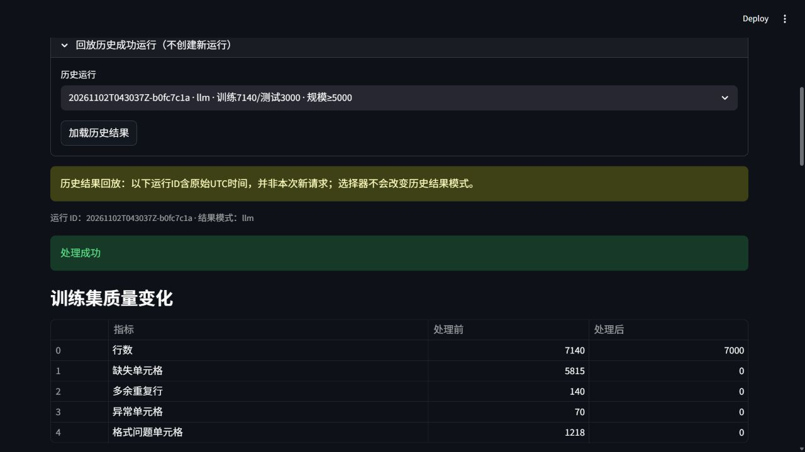
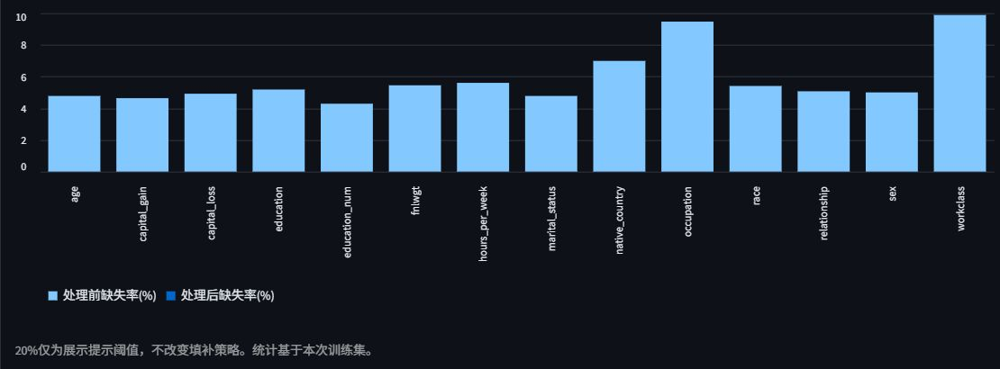

# 基于大模型的数据自动清洗与分类智能体

真实LLM与四项功能更新报告；真人跨机复现、排练及录屏待补。

## 基于大模型的数据自动清洗与分类智能体

课程项目报告 · 真实LLM与四项功能更新版 · 2026-11-02

成员：宋艳婷（A）、杨陈紫逸（B）、胡宇轩（C）、周锦晨（D）。本项目在固定Adult表格上完成质量检测、真实模型计划、白名单校验、清洗、分类和导出，规则与LLM完整集成均已通过。

| 项目 | 本次真实LLM结果 |
| --- | --- |
| 规模 | 脏训练7140→7000行；固定测试3000行 |
| 模型与策略 | DeepSeek / deepseek-flash；median与constant/Unknown |
| 分类指标 | Accuracy 85.23%；Macro-F1 0.788846 |
| 质量复查 | 训练缺失、重复、范围异常、格式问题均为0 |
| 验证范围 | 真实请求/逐次账本/生产工具；页面上传和历史回放已检查 |

本文主要运行：20261102T043037Z-b0fc7c1a（llm）；规则对照：20261102T042950Z-969fddba。模型依据仅来自训练摘要，填补、编码和标准化只在训练集拟合；两模式本次策略和成绩相同。

图1 已验证LLM成功运行的历史回放。界面明确显示原始运行ID、llm模式及回放标识；截图未发起新请求。

核心技术与材料已形成可核查证据；另一位真人跨机复现、全员排练和录屏仍待。本文不把自动测试或AI浏览器操作写成真人验收。

<!-- pagebreak -->

## 数据来源、构造与质量口径

数据来自UCI Adult，许可CC BY 4.0。[1] 完整发布集为48842行，本项目只使用adult.data中的32561行，固定seed=42抽10000行。参考池仍有原生缺失，不称为完整真值。

| 阶段 | 记录数 | 处理与用途 |
| --- | --- | --- |
| 原始adult.data | 32561 | 保留原件、来源及SHA-256 |
| 参考训练/测试 | 7000 / 3000 | 先按14特征签名分组划分 |
| 注入后训练 | 7140 | 仅训练侧注入；复制保留来源 |
| 处理后训练/测试 | 7000 / 3000 | 训练仅去重删行；测试不删行 |

同一_group_id不跨训练和测试。income、_source_id、_group_id均不作为特征。原训练参考有3行原生完全重复，对应7000行和6997组；A已核对，D独立复算一致。

| 训练质量指标 | 处理前 | 处理后 |
| --- | --- | --- |
| 记录数 | 7140 | 7000 |
| 缺失单元格 | 5815 | 0 |
| 多余重复行 | 140 | 0 |
| 范围异常单元格 | 70 | 0 |
| 格式问题单元格 | 1218 | 0 |

构造审计为新增缺失4857格、格式1198格、异常70行、复制140行。缺失检测5815=原生853+注入4857+复制带入105；格式1218=注入1198+复制带入20。各类可重叠，不能相加当作问题总行数。manifest仅作离线审计，不给检测器、模型或分类器。

执行审计：首轮去重140行、非法置空70格、填补5780格、最终去重0行。填补数为5815-105+70；测试填补431格并保留全部行、标签、来源ID和顺序。

原始文件SHA-256：5b00264637dbfec36bdeaab5676b0b309ff9eb788d63554ca0a249491c86603d。来源、清单及完整准备步骤见docs/data.md和data/manifests。

<!-- pagebreak -->

## 模型决策、工具执行与处理案例

| 阶段 | 实际方法与边界 |
| --- | --- |
| 检测 | A调用B的共享规范化视图，输入不变，统计原始缺失和解析后问题 |
| 模型计划 | 只读训练摘要；读取缺失率、偏度、四分位数和IQR并说明理由 |
| 本地校验 | 五个白名单决策字段；固定步骤本地设置；无效计划最多修正一次 |
| 清洗与测试 | B先去重/非法置空/训练拟合填补/最终去重；测试只应用训练状态 |
| 分类与导出 | D训练逻辑回归；C统一日志、审计、CSV、图像和运行结果 |

真实模型选择median：capital_gain偏度11.4218、均值1142.0185而中位数0；capital_loss偏度4.4913；fnlwgt偏度1.3849。即使部分字段较对称，当前契约仍要求所有数值列共用一种策略。

真实模型选择Unknown：workclass缺失率约9.89%、occupation约9.47%、native_country约6.99%，保留缺失为独立类别。规则模式的median/Unknown是固定设置，与模型理由来源分开记录。

### 从本次处理后CSV核对的四类案例

| 类型 | 来源与字段 | 实际输入 | 处理后 |
| --- | --- | --- | --- |
| 缺失 | S016453/native_country | '?' | Unknown |
| 重复 | S025957/(whole_row) | 'duplicated_row' | 保留一条关联记录 |
| 异常 | S002083/age | '-5' | 37.0 |
| 格式 | S010642/fnlwgt | ' 363591 ' | 363591.0 |

案例由D对照注入清单与本次真实LLM处理后CSV提取；B仍需核对报告措辞。数值摘要排除缺失、解析失败和越界值；样本少于3个时偏度为空。模型不接收测试摘要、指标或注入真值，不执行任意生成代码。

<!-- pagebreak -->

## 四项补全功能与页面使用

| 功能 | 已实现行为 |
| --- | --- |
| 训练分布自适应 | 提供合法数值偏度/四分位数/IQR与逐列缺失率，要求模型引用统计解释策略 |
| 列级质量可视化 | 14列前后缺失数/率与柱状图、训练分布和实际学得填补值 |
| 成功历史回放 | 校验完整文件、事件和路径；目录可重定位；保留原始ID/模式且不调用模型 |
| CSV上传和预检 | 固定17字段；兼容UTF-8/BOM/GB18030和常见分隔符；检查标签、来源隔离与数值观测 |

页面只在点击“开始处理”后调用唯一生产pipeline；预检、重绘和回放不新增模型请求。上传文件按内容哈希保存；应用预检每份限制20 MB。训练不足5000行可用于功能自测，页面明确提示不符合正式规模。

图2 同一LLM历史运行的列级缺失率图。数值分布在页面另表展示；20%缺失率提示仅供展示，不改变清洗策略。

不兼容输入在请求模型前拒绝：重复表头、缺/多字段、坏行、非法标签、缺来源、来源交叉、训练数值列无合法观测。保留_source_id和_group_id，不猜测任意CSV的标签、语义或来源；不支持逐列混合策略。

<!-- pagebreak -->

## 分类评估、模式对照与调用记录

分类固定14特征：6个数值字段StandardScaler，8个类别字段OneHotEncoder(handle_unknown="ignore")，随后LogisticRegression(random_state=42,max_iter=2000)。测试只转换和预测。

| 模式 | 数值/类别策略 | Accuracy / Macro-F1 |
| --- | --- | --- |
| rules | median / Unknown | 85.23% / 0.788846 |
| 真实llm | median / Unknown | 85.23% / 0.788846 |

测试3000行，<=50K为2290行，>50K为710行；矩阵行真实/列预测为[[2101,189],[254,456]]。Macro-F1为两个标签各自F1的等权平均。相同策略产生相同成绩，本次没有证明准确率提升或跨数据集泛化。

主LLM运行一次真实请求：输入1262、输出1723 token；项目累计4次真实请求共输入3404、输出2869 token，均由C逐次记账。费用未返回，保持unknown/null。temperature=0为实际发送参数；不推断服务商隐含参数或底层权重版本。

开发账本独立于运行账本：开发内部模型标识、次数、token和计费不可核实时留null，不把订阅或未知成本记成0元。故障纠错由明确测试替身验证，不冒称真实服务自然报错。

<!-- pagebreak -->

## 复现、成员贡献与验收边界

| 成员 | 可核实的模块与增量 |
| --- | --- |
| A 宋艳婷 | 数据准备与检测；核对数据说明、原生重复和计数差值 |
| B 杨陈紫逸 | 共享规范化、训练清洗、测试转换及审计 |
| C 胡宇轩 | 原模型客户端、计划、pipeline和日志实现 |
| D 周锦晨 | 分类/页面/CLI、集成与材料；代补C验收/边界及A/C统计增强；四项功能和真实模型验证 |

角色、姓名已确认；不推断贡献比例。D代完成的代码、验证与材料单列，不归入C原成员独立工作。口头展示安排与B案例文字仍需成员核对。

### 已完成的技术验证

共享契约1.0冻结不变。A60项断言、B33项断言、C16项测试及D新增16类拒绝/编码/真实流程/历史/AppTest通过；main rules与真实LLM完整门禁通过。浏览器AI操作完成正式本地CSV/双文件上传、图表和回放检查；真实运行和受控故障分别归档。

复现：按README安装固定依赖，prepare_data.py --seed 42 --sample-size 10000；运行CLI或Streamlit。main执行check_integration.py --mode rules/llm。新终端需本地加载LLM_API_URL/KEY/MODEL，.env不自动加载；密钥不入源码、日志和交付包。

### 仍需实际完成的验收

另一位成员从安装依赖、准备数据开始跨机复现；四人确认讲述安排并实际排练；录制真实运行或明确标识的成功回放。本机检查与AI操作不能代替这些真人事项。原生PowerPoint检查状态以本轮验收记录为准。

### 局限与来源

固定Adult结构与数值边界，只有全局两类填补策略；尚未评价复杂语义冲突、公平性或外部数据泛化，不用于真实个人决策。模型本次能引用统计解释选择，但没有证明优于固定规则。

[1] Becker, B. & Kohavi, R. (1996). Adult [Dataset]. UCI Machine Learning Repository. DOI:10.24432/C5XW20，https://archive.ics.uci.edu/dataset/2/adult，CC BY 4.0。

[2] 本仓库源码、C/D证据与AI账本；主要运行outputs/smoke_runs/20261102T043037Z-b0fc7c1a/，规则对照outputs/smoke_runs/20261102T042950Z-969fddba/。实际接口https://api.deepseek.com/chat/completions，模型标识deepseek-flash。
